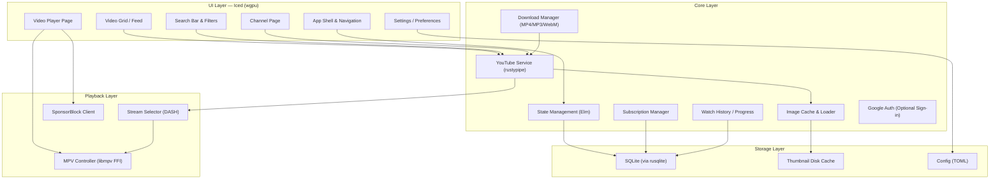
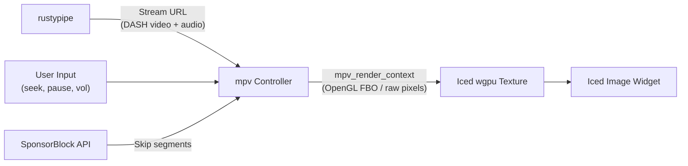
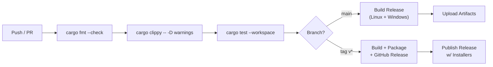

# 🚀 Rustube — Implementation Plan

> A blazingly fast, native YouTube desktop client written entirely in Rust.
> Runs on 4 GB RAM. Linux + Windows. Not a browser. Looks exactly like YouTube.

---

## 1. Project Vision & Constraints

| Dimension | Decision |
|---|---|
| **Language** | 100% Rust (no Electron, no embedded browser) |
| **Platforms** | Linux (X11 + Wayland), Windows 10+ |
| **RAM budget** | ≤ 200 MB idle, ≤ 400 MB during 1080p playback (target: 4 GB machines) |
| **Binary size** | ≤ 30 MB (stripped, without bundled runtime) |
| **Data source** | YouTube Innertube API via `rustypipe` (works without account, optional Google sign-in supported) |
| **Video playback** | `libmpv` via FFI (hardware-accelerated decoding) |
| **GUI framework** | **Iced** (Elm architecture, `wgpu` renderer, used by COSMIC desktop) |
| **Downloads** | Built-in download manager — MP4, MP3, WebM, M4A, and other formats with quality selection |
| **Hover preview** | Off by default, toggleable in settings |
| **License** | MIT / Apache-2.0 dual license |

---

## 2. Architecture Overview



---

## 3. Technology Stack

### 3.1 Core Dependencies

| Crate | Purpose | Why This One |
|---|---|---|
| [`iced`](https://crates.io/crates/iced) | GUI framework | Elm architecture, native `wgpu` rendering, COSMIC-proven, excellent layout system. No webview. |
| [`rustypipe`](https://crates.io/crates/rustypipe) | YouTube Innertube API client | Most complete Rust YouTube client — player streams, search, channels, playlists, comments, subtitles. NewPipe-inspired. |
| [`rustypipe-botguard`](https://crates.io/crates/rustypipe-botguard) | PO Token generation | Required to bypass YouTube's BotGuard for stream URLs. Companion to rustypipe. |
| [`libmpv` / `mpv`](https://crates.io/crates/libmpv) | Video/audio playback | Industry-standard media player with HW-accelerated decoding (VA-API, NVDEC, D3D11). Tiny memory footprint. |
| [`tokio`](https://crates.io/crates/tokio) | Async runtime | Industry standard; required by rustypipe and reqwest. |
| [`reqwest`](https://crates.io/crates/reqwest) | HTTP client | Used under the hood by rustypipe; also for thumbnail/image fetching. |
| [`rusqlite`](https://crates.io/crates/rusqlite) | Local database | Subscriptions, history, bookmarks. ~0 overhead. |
| [`image`](https://crates.io/crates/image) | Image decoding | Decode JPEG/WebP thumbnails for Iced texture display. |
| [`serde` / `toml`](https://crates.io/crates/serde) | Configuration | User preferences serialization. |
| [`directories`](https://crates.io/crates/directories) | XDG / AppData paths | Cross-platform config/cache/data directory resolution. |
| [`open`](https://crates.io/crates/open) | URL opener | Open links in system browser when needed. |

### 3.2 Optional / Enhancement Dependencies

| Crate | Purpose |
|---|---|
| [`tracing`](https://crates.io/crates/tracing) | Structured logging & diagnostics |
| [`chrono`](https://crates.io/crates/chrono) / [`time`](https://crates.io/crates/time) | Timestamp formatting ("2 hours ago") |
| [`fuzzy-matcher`](https://crates.io/crates/fuzzy-matcher) | Local subscription/history search |
| [`notify`](https://crates.io/crates/notify) | File system watcher for config hot-reload |
| [`arboard`](https://crates.io/crates/arboard) | Clipboard access (copy video URL) |
| [`dark-light`](https://crates.io/crates/dark-light) | Detect system dark/light mode preference |
| [`oauth2`](https://crates.io/crates/oauth2) | Google OAuth2 device flow for optional sign-in |
| [`ffmpeg-sidecar`](https://crates.io/crates/ffmpeg-sidecar) | FFmpeg process wrapper for muxing/remuxing downloads (MP4 mux, MP3 extraction) |
| [`indicatif`](https://crates.io/crates/indicatif) | Progress bar primitives (adapted for download UI) |

---

## 4. Project Structure

```
rustube/
├── Cargo.toml                   # Workspace root
├── Cargo.lock
├── README.md
├── LICENSE-MIT
├── LICENSE-APACHE
├── assets/
│   ├── icons/                   # App icons (SVG, PNG, ICO)
│   ├── fonts/                   # Bundled fonts (Inter, Noto Sans)
│   └── logo.svg
├── crates/
│   ├── rustube-core/            # Core business logic (no UI)
│   │   ├── Cargo.toml
│   │   └── src/
│   │       ├── lib.rs
│   │       ├── youtube/         # YouTube service layer
│   │       │   ├── mod.rs
│   │       │   ├── client.rs    # RustyPipe wrapper & caching
│   │       │   ├── models.rs    # Domain models (Video, Channel, etc.)
│   │       │   ├── search.rs    # Search + filters
│   │       │   ├── feed.rs      # Trending, subscriptions feed
│   │       │   └── stream.rs    # Stream selection & URL resolution
│   │       ├── player/          # MPV integration
│   │       │   ├── mod.rs
│   │       │   ├── controller.rs   # Play/pause/seek/volume
│   │       │   ├── mpv_ffi.rs      # libmpv bindings
│   │       │   └── sponsorblock.rs # SponsorBlock segment skipping
│   │       ├── storage/         # Persistence
│   │       │   ├── mod.rs
│   │       │   ├── database.rs  # SQLite schema & queries
│   │       │   ├── cache.rs     # Thumbnail disk cache (LRU)
│   │       │   └── config.rs    # TOML config read/write
│   │       ├── auth/            # Optional Google sign-in
│   │       │   ├── mod.rs
│   │       │   ├── oauth.rs     # OAuth2 device flow
│   │       │   └── session.rs   # Token storage & refresh
│   │       ├── download/        # Multi-format download manager
│   │       │   ├── mod.rs
│   │       │   ├── manager.rs   # Queue, progress tracking, concurrency
│   │       │   ├── formats.rs   # MP4, MP3, WebM, M4A, OPUS format handling
│   │       │   └── muxer.rs     # FFmpeg/remux for audio extraction
│   │       └── subscription/    # Local subscription management
│   │           ├── mod.rs
│   │           ├── manager.rs   # Add/remove/import/export
│   │           └── feed.rs      # Aggregated feed builder
│   ├── rustube-ui/              # Iced GUI application
│   │   ├── Cargo.toml
│   │   └── src/
│   │       ├── main.rs          # Entry point, Iced::run()
│   │       ├── app.rs           # Root Application (state, update, view)
│   │       ├── message.rs       # Global message enum
│   │       ├── theme.rs         # Custom theme (YouTube-inspired colors)
│   │       ├── router.rs        # Page routing / navigation stack
│   │       ├── pages/           # Full-page views
│   │       │   ├── mod.rs
│   │       │   ├── home.rs         # Home / trending feed
│   │       │   ├── search.rs       # Search results page
│   │       │   ├── watch.rs        # Video player page
│   │       │   ├── channel.rs      # Channel profile page
│   │       │   ├── playlist.rs     # Playlist view
│   │       │   ├── subscriptions.rs # Subscriptions feed
│   │       │   ├── history.rs      # Watch history
│   │       │   ├── downloads.rs    # Downloaded videos
│   │       │   └── settings.rs     # App settings
│   │       ├── widgets/         # Reusable UI components
│   │       │   ├── mod.rs
│   │       │   ├── video_card.rs      # Thumbnail + title + metadata card
│   │       │   ├── video_grid.rs      # Responsive grid layout
│   │       │   ├── sidebar.rs         # Left navigation sidebar (YouTube-style)
│   │       │   ├── top_bar.rs         # Hamburger + logo + search + user avatar
│   │       │   ├── nav_buttons.rs     # Back ◀ / Forward ▶ navigation
│   │       │   ├── player_controls.rs # Play/pause, seek bar, volume
│   │       │   ├── comment.rs         # Comment thread renderer
│   │       │   ├── channel_chip.rs    # Channel avatar + name chip
│   │       │   ├── loading.rs         # Skeleton loaders / spinners
│   │       │   ├── pill_button.rs     # Category filter pills
│   │       │   ├── download_dialog.rs # Format/quality picker (MP4/MP3/WebM/M4A)
│   │       │   └── tooltip.rs         # Hover tooltips
│   │       └── utils/           # UI helpers
│   │           ├── mod.rs
│   │           ├── format.rs    # Duration, view count formatting
│   │           ├── icons.rs     # Icon constants
│   │           └── image_loader.rs # Async thumbnail loader
│   └── rustube-cli/             # (Optional) CLI companion
│       ├── Cargo.toml
│       └── src/
│           └── main.rs
├── build.rs                     # Build script (embed version, icons)
└── .github/
    └── workflows/
        ├── ci.yml               # Lint + test + clippy
        └── release.yml          # Cross-compile + package + release
```

---

## 5. UI Design — YouTube-Inspired, Adjusted

### 5.1 Design Principles

1. **Pixel-faithful to YouTube** — Use the actual YouTube website as the direct reference. Same layout structure, same spacing patterns, same visual hierarchy. No reinventing the wheel.
2. **Dark-first** — Default dark theme (following system preference), with a polished light mode — matching YouTube's own dark/light modes.
3. **Keyboard-first** — Full keyboard navigation, vim-like optional keybindings.
4. **Responsive** — Adapts grid columns from 1 (narrow) to 5+ (ultrawide) based on window width, exactly like YouTube's responsive breakpoints.
5. **Hover preview** — Off by default. Toggleable in settings for those who want it.

### 5.2 Layout Wireframe — Home Page (matches YouTube)

```
┌─────────────────────────────────────────────────────────────────┐
│  ≡  🔴 Rustube      [🔍 Search.......................] 🎤  ⬇ 🔔 👤│ ← Top Bar
│     ◀ ▶                                                         │ ← Nav buttons
├──────────┬──────────────────────────────────────────────────────┤
│          │  [All] [Music] [Gaming] [News] [Live] [Sports] [>]  │ ← Category Pills
│  🏠 Home │──────────────────────────────────────────────────────│
│  🔥 Expl │  ┌─────────┐  ┌─────────┐  ┌─────────┐  ┌────────┐│
│  🩳 Short│  │ ▶ thumb  │  │ ▶ thumb  │  │ ▶ thumb  │  │▶ thumb ││
│  📺 Subs │  │ Title... │  │ Title... │  │ Title... │  │Title...││ ← Video Grid
│          │  │ Channel  │  │ Channel  │  │ Channel  │  │Channel ││   (YouTube
│  ─────── │  │ 1.2M·3mo │  │ 500K·1w  │  │ 2.5M·2d  │  │80K·5h  ││    spacing)
│  📚 Lib  │  └─────────┘  └─────────┘  └─────────┘  └────────┘│
│  ⏱ Hist  │                                                     │
│  ⬇ Down  │  ┌─────────┐  ┌─────────┐  ┌─────────┐  ┌────────┐│
│          │  │ ▶ thumb  │  │ ▶ thumb  │  │ ▶ thumb  │  │▶ thumb ││
│  ─────── │  │ ...      │  │ ...      │  │ ...      │  │...     ││
│  Subscr: │  └─────────┘  └─────────┘  └─────────┘  └────────┘│
│  @chan1   │                                                     │
│  @chan2   │  [Load More / Infinite Scroll]                      │
│  @chan3   │                                                     │
│  ─────── │                                                     │
│  ⚙ Set   │                                                     │
└──────────┴──────────────────────────────────────────────────────┘
```

### 5.3 Video Watch Page (matches YouTube layout)

```
┌──────────────────────────────────────────────────────────────────┐
│  ≡  🔴 Rustube      [🔍 Search.......................] 🎤  ⬇ 🔔 👤 │
│     ◀ ▶                                                          │
├──────────────────────────────────────────────────────────────────┤
│                                                                  │
│  ┌──────────────────────────────────────────┐  ┌──────────────┐ │
│  │                                          │  │  Up Next      │ │
│  │         MPV Video Player                 │  │               │ │
│  │         (HW Accelerated)                 │  │  ┌──────────┐ │ │
│  │                                          │  │  │ ▶ thumb  │ │ │
│  ├──────────────────────────────────────────┤  │  │ Title    │ │ │
│  │  ▶ ◼ ▶▶  ━━━●━━━━━━━━  3:24/10:31      │  │  │ Channel  │ │ │
│  │  🔊━━● 🔲 ⚙ CC 🖥                       │  │  │ 50K·2d   │ │ │
│  └──────────────────────────────────────────┘  │  └──────────┘ │ │
│                                                │               │ │
│  Video Title Here — Full Title                 │  ┌──────────┐ │ │
│  1,234,567 views • Nov 3, 2026                 │  │ ▶ thumb  │ │ │
│                                                │  │ Title    │ │ │
│  ┌──────┐ Channel Name            [Subscribe]  │  │ Channel  │ │ │
│  │avatar│ 1.2M subscribers                     │  └──────────┘ │ │
│  └──────┘                                      │               │ │
│  [👍 12K] [👎] [↗ Share] [⬇ Download] [💾 Save] │  ┌──────────┐ │ │
│                                                │  │ ▶ thumb  │ │ │
│  ┌──────────────────────────────────────────┐  │  │ ...      │ │ │
│  │ 📝 Description text here...              │  │  └──────────┘ │ │
│  │ Show more ▼                              │  │               │ │
│  └──────────────────────────────────────────┘  │               │ │
│                                                │               │ │
│  💬 1,234 Comments  [Sort by ▼]                │               │ │
│  ┌──────────────────────────────────────────┐  │               │ │
│  │ 🔲 @username • 2 days ago               │  │               │ │
│  │ Comment text here...                    │  │               │ │
│  │ 👍 42  👎  💬 Reply (3)                  │  │               │ │
│  └──────────────────────────────────────────┘  └──────────────┘ │
│                                                                  │
└──────────────────────────────────────────────────────────────────┘
```

### 5.4 Color Palette

| Token | Dark Mode | Light Mode | Usage |
|---|---|---|---|
| `bg-primary` | `#0f0f0f` | `#ffffff` | Main background |
| `bg-secondary` | `#1a1a1a` | `#f2f2f2` | Sidebar, cards |
| `bg-elevated` | `#272727` | `#e5e5e5` | Hover states, modals |
| `text-primary` | `#f1f1f1` | `#0f0f0f` | Titles, body text |
| `text-secondary` | `#aaaaaa` | `#606060` | Metadata, timestamps |
| `accent` | `#ff4444` | `#cc0000` | Rustube brand red |
| `accent-hover` | `#ff6666` | `#dd2222` | Button hovers |
| `link` | `#3ea6ff` | `#065fd4` | Clickable text |
| `success` | `#2ba640` | `#2ba640` | Positive actions |
| `border` | `#333333` | `#d3d3d3` | Dividers, borders |

---

## 6. Feature Roadmap — Phased Delivery

### Phase 1: Foundation (Weeks 1–4)
> **Goal:** Skeleton app that can search YouTube, display results, and play a video.

- [x] Project scaffolding (workspace, crate structure, CI)
- [ ] Iced app shell with top bar, sidebar, and content area — matching YouTube's layout
- [ ] ◀ ▶ Navigation buttons (back/forward history stack)
- [ ] Custom dark/light theme (YouTube color-matched)
- [ ] `rustypipe` integration — search videos by query
- [ ] Video card widget (thumbnail, title, channel, view count, age)
- [ ] Responsive video grid layout (matching YouTube's breakpoints)
- [ ] Basic video player page — launch `libmpv` with selected stream URL
- [ ] Player controls: play/pause, seek bar, volume, fullscreen
- [ ] Basic keyboard shortcuts (Space, F, M, ←, →, J, K, L)

### Phase 2: Core Experience (Weeks 5–8)
> **Goal:** A usable daily-driver YouTube client.

- [ ] Home/trending feed page
- [ ] Channel page (banner, avatar, tabs: videos, shorts, playlists, about)
- [ ] Playlist page with video list
- [ ] Video description panel (expandable, clickable timestamps/links)
- [ ] Comments section (threaded, with pagination)
- [ ] Related/recommended videos sidebar on watch page
- [ ] Search filters (upload date, type, duration, sort by)
- [ ] Category filter pills on home page
- [ ] Loading skeletons / shimmer placeholders
- [ ] Navigation history stack (back/forward)

### Phase 3: Local Data & Subscriptions (Weeks 9–11)
> **Goal:** Offline-capable subscription and history management.

- [ ] SQLite database setup (migrations with `refinery` or manual)
- [ ] Local subscription manager (subscribe/unsubscribe without Google account)
- [ ] Subscription feed — aggregated latest videos from subscribed channels
- [ ] Import subscriptions from YouTube (OPML / JSON takeout)
- [ ] Export subscriptions
- [ ] Watch history — track watched videos and resume position
- [ ] Watch progress bar on thumbnails (red progress indicator)
- [ ] Bookmarks / "Watch Later" local playlist

### Phase 4: Polish & Power Features (Weeks 12–16)
> **Goal:** Differentiation features that make Rustube a joy to use.

- [ ] **SponsorBlock integration** — auto-skip sponsored segments
- [ ] **Video download manager** — multi-format support:
  - MP4 (video + audio, muxed)
  - MP3 (audio extracted, re-encoded)
  - WebM (native video format)
  - M4A / OPUS (audio-only, native)
  - Quality selector per download (144p → 4K)
  - Download queue with progress bars, pause/resume, concurrent downloads
- [ ] **Optional Google sign-in** — OAuth2 device flow for:
  - Syncing subscriptions from YouTube account
  - Accessing private playlists and liked videos
  - Commenting (if API permits)
  - Sign-out anytime; app remains fully functional without account
- [ ] **Hover preview** — opt-in thumbnail video preview (off by default, toggle in settings)
- [ ] **Picture-in-Picture (PiP)** — floating mini-player while browsing
- [ ] **Playback speed control** (0.25x – 3.0x)
- [ ] **Subtitle/caption** display and selection
- [ ] **Quality selector** — choose resolution (144p → 4K)
- [ ] **Thumbnail disk cache** — LRU cache with configurable size limit
- [ ] **Settings page** — theme, default quality, cache size, SponsorBlock, hover preview toggle, keybindings
- [ ] **System tray** support (minimize to tray, background audio playback)
- [ ] **Notification** — new videos from subscribed channels

### Phase 5: Release Engineering (Weeks 17–18)
> **Goal:** Ship it.

- [ ] Cross-compilation CI/CD (Linux: AppImage/Flatpak, Windows: MSI/portable)
- [ ] Auto-updater mechanism
- [ ] Crash reporting / diagnostics (opt-in)
- [ ] README, screenshots, documentation
- [ ] First public release (v0.1.0)

---

## 7. MPV Integration Strategy

> [!IMPORTANT]
> Video playback is the hardest subsystem. The approach uses **libmpv in render API mode**, rendering frames into a shared texture that Iced can composite.

### Architecture



### Implementation Steps

1. **Initialize `libmpv`** in render API (`MPV_RENDER_API_TYPE_OPENGL` or software fallback).
2. **Create a render context** that outputs frames to an FBO or raw pixel buffer.
3. **Each Iced tick**: request a frame from mpv → upload to `wgpu` texture → display as `iced::widget::Image`.
4. **Fallback path**: If render API integration proves too complex, spawn mpv as a **child window** embedded via platform-specific window handle passing (`--wid` flag on Linux, HWND on Windows). This is simpler but limits overlay capability.

### Fallback: External mpv Window

If embedded rendering is blocked:
- Use `std::process::Command` to spawn `mpv --wid=<xid>` (Linux) or `mpv --wid=<hwnd>` (Windows)
- Control via mpv's IPC socket (`--input-ipc-server`)
- Iced draws controls as an overlay panel docked below/above the video

---

## 8. Performance Budget

> [!TIP]
> Key to running well on 4 GB RAM: lazy loading, LRU caches, and streaming everything.

| Resource | Budget | Strategy |
|---|---|---|
| **Idle RAM** | ≤ 150 MB | No pre-loaded videos. Thumbnails loaded on-demand and LRU-cached. |
| **Playback RAM** | ≤ 350 MB | mpv handles buffering efficiently (~50-100 MB). GPU textures for current frame only. |
| **Thumbnail cache (disk)** | 200 MB default, configurable | LRU eviction. WebP preferred (smaller than JPEG). |
| **Database** | < 10 MB typical | SQLite WAL mode. Index on video_id, channel_id. |
| **CPU idle** | < 2% | Iced only redraws on events (no continuous rendering when not playing). |
| **CPU playback** | < 15% (w/ HW accel) | VA-API (Linux), D3D11 (Windows) hardware decoding. |
| **Startup time** | < 1.5 seconds | Lazy init: DB and network calls after first paint. |
| **Binary size** | < 25 MB | LTO, strip, `opt-level = "s"` for release. Dynamic link to mpv. |

---

## 9. Data Models

### Core Domain Types

```rust
/// A video in search results, feed, or related videos
pub struct VideoItem {
    pub id: String,
    pub title: String,
    pub channel: ChannelBadge,
    pub thumbnail_url: String,
    pub duration: Option<Duration>,        // None for live
    pub view_count: Option<u64>,
    pub published_text: String,            // "2 days ago"
    pub is_live: bool,
}

pub struct ChannelBadge {
    pub id: String,
    pub name: String,
    pub avatar_url: Option<String>,
    pub is_verified: bool,
}

/// Full video details (watch page)
pub struct VideoDetails {
    pub id: String,
    pub title: String,
    pub description: String,
    pub channel: ChannelBadge,
    pub view_count: u64,
    pub like_count: Option<u64>,
    pub published_date: DateTime<Utc>,
    pub category: String,
    pub tags: Vec<String>,
    pub chapters: Vec<Chapter>,
    pub streams: Vec<StreamInfo>,
    pub captions: Vec<CaptionTrack>,
}

pub struct StreamInfo {
    pub url: String,
    pub quality: String,                   // "1080p", "720p"
    pub mime_type: String,
    pub bitrate: u64,
    pub is_audio_only: bool,
    pub codec: String,
}

/// Local subscription record
pub struct Subscription {
    pub channel_id: String,
    pub channel_name: String,
    pub avatar_url: Option<String>,
    pub subscribed_at: DateTime<Utc>,
    pub last_checked: DateTime<Utc>,
}

/// Watch history entry
pub struct HistoryEntry {
    pub video_id: String,
    pub title: String,
    pub channel_name: String,
    pub thumbnail_url: String,
    pub duration: Duration,
    pub watched_at: DateTime<Utc>,
    pub progress: Duration,                // Resume position
}
```

---

## 10. Database Schema (SQLite)

```sql
CREATE TABLE subscriptions (
    channel_id   TEXT PRIMARY KEY,
    channel_name TEXT NOT NULL,
    avatar_url   TEXT,
    subscribed_at TEXT NOT NULL DEFAULT (datetime('now')),
    last_checked  TEXT NOT NULL DEFAULT (datetime('now'))
);

CREATE TABLE watch_history (
    id           INTEGER PRIMARY KEY AUTOINCREMENT,
    video_id     TEXT NOT NULL,
    title        TEXT NOT NULL,
    channel_name TEXT NOT NULL,
    thumbnail_url TEXT,
    duration_secs INTEGER NOT NULL,
    progress_secs INTEGER NOT NULL DEFAULT 0,
    watched_at   TEXT NOT NULL DEFAULT (datetime('now')),
    UNIQUE(video_id, watched_at)
);
CREATE INDEX idx_history_video ON watch_history(video_id);
CREATE INDEX idx_history_date  ON watch_history(watched_at);

CREATE TABLE bookmarks (
    video_id     TEXT PRIMARY KEY,
    title        TEXT NOT NULL,
    channel_name TEXT NOT NULL,
    thumbnail_url TEXT,
    duration_secs INTEGER,
    added_at     TEXT NOT NULL DEFAULT (datetime('now'))
);

CREATE TABLE downloads (
    id           INTEGER PRIMARY KEY AUTOINCREMENT,
    video_id     TEXT NOT NULL,
    title        TEXT NOT NULL,
    file_path    TEXT NOT NULL,
    format       TEXT NOT NULL,              -- "mp4", "webm", "m4a"
    quality      TEXT,
    file_size    INTEGER,
    status       TEXT NOT NULL DEFAULT 'pending', -- pending, downloading, complete, failed
    progress     REAL NOT NULL DEFAULT 0.0,  -- 0.0 to 1.0
    created_at   TEXT NOT NULL DEFAULT (datetime('now'))
);

CREATE TABLE settings (
    key   TEXT PRIMARY KEY,
    value TEXT NOT NULL
);
```

---

## 11. Keyboard Shortcuts

| Key | Action |
|---|---|
| `Space` / `K` | Play / Pause |
| `F` / `F11` | Toggle fullscreen |
| `M` | Toggle mute |
| `J` / `←` | Seek backward 10s / 5s |
| `L` / `→` | Seek forward 10s / 5s |
| `↑` / `↓` | Volume up / down 5% |
| `.` / `,` | Next / previous frame (paused) |
| `<` / `>` | Decrease / increase playback speed |
| `C` | Toggle captions |
| `T` | Toggle theater mode |
| `I` | Toggle mini-player (PiP) |
| `/` / `Ctrl+K` | Focus search bar |
| `Esc` | Exit fullscreen / close modal |
| `N` | Next video (in playlist) |
| `P` | Previous video (in playlist) |
| `Ctrl+D` | Download current video (opens format picker) |
| `Alt+←` / `Alt+→` | Navigate back / forward |
| `Backspace` | Navigate back |

---

## 12. Build & Distribution

### Build Profiles

```toml
# Cargo.toml (workspace root)
[profile.release]
lto = "fat"
codegen-units = 1
strip = true
opt-level = 2           # Balance speed and size
panic = "abort"

[profile.release-small]
inherits = "release"
opt-level = "s"          # Optimize for size
```

### Platform Packaging

| Platform | Format | Tool |
|---|---|---|
| Linux | AppImage | `appimagetool` + `linuxdeploy` |
| Linux | Flatpak | `flatpak-builder` manifest |
| Linux | .deb / .rpm | `cargo-deb`, `cargo-generate-rpm` |
| Windows | .msi installer | `wix` toolset |
| Windows | Portable .exe | Zip archive with mpv DLLs |

### CI/CD Pipeline (GitHub Actions)



---

## 13. Risk Assessment & Mitigations

| Risk | Severity | Mitigation |
|---|---|---|
| **YouTube API breakage** (Innertube changes) | 🔴 High | `rustypipe` is actively maintained and NewPipe-inspired. Pin versions, monitor upstream. Implement Invidious/Piped API as fallback data source. |
| **BotGuard / PO Token blocks** | 🔴 High | Use `rustypipe-botguard`. Keep updated. Consider bundling fallback extraction via `yt-dlp` subprocess. |
| **MPV embedding complexity** | 🟡 Medium | Start with child-window embedding (`--wid`), iterate to render API. Both paths are viable. |
| **Iced maturity gaps** (missing widgets) | 🟡 Medium | Build custom widgets. Iced's widget API is flexible. COSMIC ecosystem proves it works at scale. |
| **Cross-platform video HW acceleration** | 🟡 Medium | mpv handles this transparently. Test on both Intel/AMD (VA-API) and NVIDIA (NVDEC). |
| **Legal / ToS concerns** | 🟡 Medium | No Google account required. No ads removed (they aren't fetched). Similar to NewPipe/FreeTube legal standing. |

---

## 14. Differences from YouTube Web

> [!NOTE]
> Rustube is inspired by YouTube's UI patterns but makes deliberate changes for a desktop-native experience.

| Aspect | YouTube Web | Rustube |
|---|---|---|
| **Ads** | Pre-roll, mid-roll, banner | None (streams fetched directly) |
| **Account** | Google account required for most features | Optional Google sign-in; fully functional without it (local subs, history, etc.) |
| **Data storage** | Google servers | SQLite on your machine (+ cloud sync if signed in) |
| **Resource usage** | 500 MB–2 GB (Chrome/Electron) | < 350 MB including video playback |
| **Tracking** | Extensive Google telemetry | Zero telemetry |
| **Video player** | Custom HTML5 + JavaScript | libmpv with HW acceleration |
| **Layout** | YouTube's web layout | Matches YouTube's layout exactly — same structure, navigation, and visual hierarchy |
| **Hover preview** | Auto-plays preview on thumbnail hover | Off by default, toggleable in settings |
| **Keyboard nav** | Limited | Full keyboard-driven navigation |
| **SponsorBlock** | Browser extension needed | Built-in, toggleable |
| **Download** | Premium only | Built-in — MP4, MP3, WebM, M4A, and more with quality selection |
| **Shorts** | Full vertical video player | Displayed as regular videos (no infinite scroll TikTok UI) |
| **Navigation** | Browser back/forward | Built-in ◀ ▶ navigation buttons + keyboard shortcuts |

---

## 15. Getting Started — First Commands

```bash
# Initialize the workspace
cd /home/haziq/Documents/Projects/Rustube

# Create workspace Cargo.toml
cargo init --name rustube

# System dependencies (Fedora/RHEL)
sudo dnf install mpv-devel gstreamer1-devel gcc pkg-config

# System dependencies (Ubuntu/Debian)
# sudo apt install libmpv-dev libgstreamer1.0-dev gcc pkg-config

# System dependencies (Windows - via vcpkg or manual)
# Download mpv-dev from https://mpv.io/installation/

# Add core dependencies
cargo add iced --features "wgpu,tokio,image"
cargo add rustypipe
cargo add tokio --features "full"
cargo add reqwest --features "json"
cargo add rusqlite --features "bundled"
cargo add serde --features "derive"
cargo add toml
cargo add directories
cargo add tracing tracing-subscriber
cargo add image
cargo add chrono --features "serde"

# Verify it builds
cargo build
```

---

> [!IMPORTANT]
> **Next Steps:** Approve this plan and I will begin scaffolding the workspace, setting up the crate structure, and implementing Phase 1 starting with the Iced app shell and YouTube search integration.
